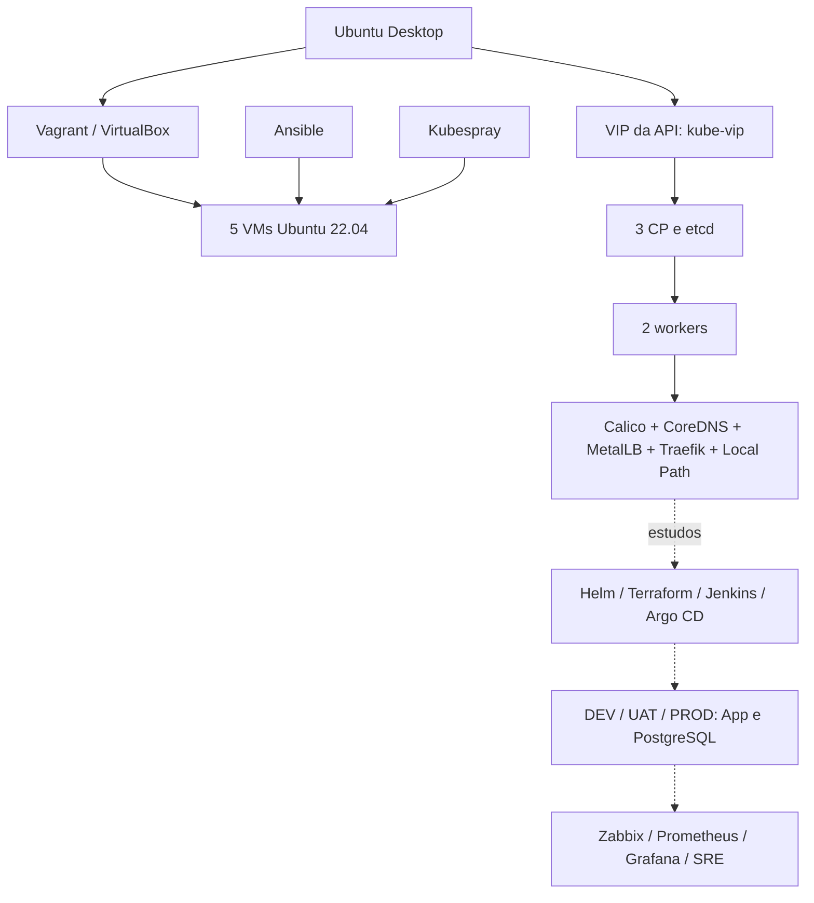

# Arquitetura

NAT por VM para egress e rede host-only comum para endereços privados, SSH, API, etcd e workloads. Não há bridge nem encaminhamento público. Exemplos de CIDRs estão no config. Os IPs de Pods e Services são virtuais e independentes da rede host-only. Kube-vip anuncia exclusivamente o VIP da API por ARP, com eleição de líder nos CP; não é o MetalLB. API TLS 6443; VIP incluído nos SAN. O VIP aponta ao CP que o detém; não prometemos balanceamento simultâneo de conexões ou failover comprovado. O Kubespray faz bootstrap e ajustes de kernel/swap/runtime. Calico VXLAN utiliza UDP 4789, MTU de workload 1450 para interface Ethernet 1500 (validar no host). SSH TCP 22 host-only, etcd TCP 2379/2380 entre CP, kubelet TCP 10250 e demais fluxos internos Kubernetes, DNS UDP/TCP 53, MetalLB memberlist TCP/UDP 7946 e ARP, HTTP 80/HTTPS 443 do Traefik via pool reservado. Não expor portas à LAN ou internet. Não aplicar firewall global por automação.

HA lógica tolera uma falha de membro de etcd se os demais estiverem saudáveis. Todos os discos/VMs dependem do mesmo computador: não é HA física. Storage local em `/opt/local-path-provisioner` na VM, sem replicação ou quota física; espaço real deve ser observado. `Retain` protege contra remoção automática de dados do PVC de estudo, mas não é backup. `sre-test` usa Delete só para volumes efêmeros. Não aplicar alterações em volumes existentes.
