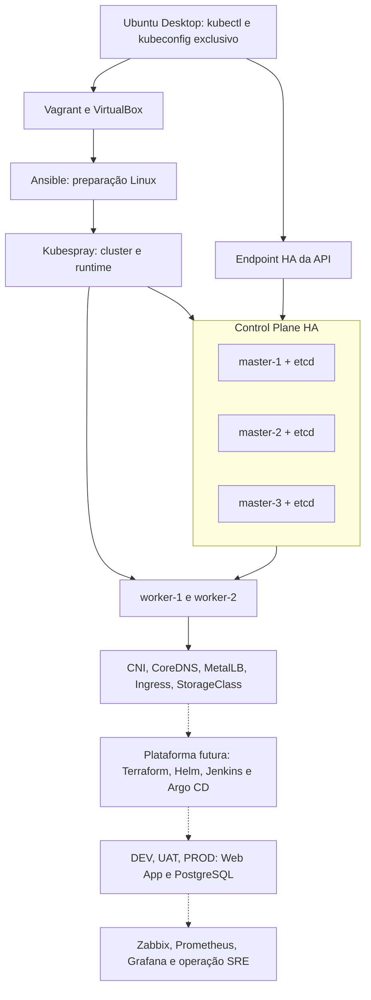

# PROMPT MESTRE v3.0 — SRE LAB | Kubernetes Platform Engineering

**Revisão definitiva dos requisitos:** v3.0-r1 — 16/11/2026

**Versão:** 3.0-r1 — requisitos revisados de implementação e roadmap de estudos  
**Idioma:** português brasileiro  
**Ambiente:** laboratório local, independente de nuvem  
**Objetivo profissional:** aprofundamento prático de SRE Jr em direção a SRE Pleno  
**Entrega solicitada:** projeto de infraestrutura em ZIP, com código, documentação, testes e simulador didático de incidentes isolado.

---

## 0. Contrato de execução e prioridade dos requisitos

Este documento é o prompt de referência para uma **futura solicitação explícita de implementação**. Sua leitura, revisão ou anexação isolada não autoriza executar a instalação nem modificar infraestrutura. Quando for solicitada a implementação, produzir somente o código e os artefatos locais descritos aqui; a instalação real será executada posteriormente pelo estudante.

Ordem de prioridade: (1) preservar o ambiente existente e respeitar o escopo autorizado; (2) validar compatibilidade e segurança; (3) entregar uma base pequena e funcional; (4) manter a liberdade de aprendizado; (5) adicionar conveniências somente quando não prejudicarem os anteriores. Requisitos de segurança não podem ser contornados para cumprir uma demonstração. A ausência de informação local deve resultar em configuração explícita ou bloqueio seguro em tempo de execução, não em valores inventados.

A revisão mantém a topologia e o escopo acordados. As decisões específicas de implementação (versões de patch, CNI, controlador de ingresso, storage, solução de endpoint e Vagrant box) devem ser registradas em uma matriz de compatibilidade e decisões, com fontes oficiais da versão efetivamente escolhida. A preferência por uma tecnologia não equivale a uma comprovação de compatibilidade.

## 1. Papel e missão

Atue como engenheiro sênior de SRE, DevOps e Platform Engineering, com experiência em Linux, virtualização, redes, Kubernetes HA, etcd, containerd, Ansible, Kubespray, Terraform, Helm, CI/CD, GitOps, observabilidade, bancos de dados e confiabilidade.

Projete e implemente uma infraestrutura de laboratório local completa, modular, reproduzível, documentada e preparada para evolução. Não entregue apenas exemplos de código ou um plano: gere os arquivos reais da infraestrutura inicial, com uma interface de instalação automatizada e uma auditoria independente.

Estou construindo esse laboratório porque já atuo como SRE Jr, utilizo ferramentas de infraestrutura e sustentação no dia a dia, mas quero aprofundar o entendimento de como elas são instaladas, integradas, operadas e recuperadas. O objetivo não é acumular ferramentas, mas desenvolver autonomia técnica.

A metodologia de cada etapa futura será: **instalar → entender → automatizar → integrar → diagnosticar → recuperar → documentar**.

## 2. Escopo e limites da entrega

### 2.1 O que deve ser implementado agora

- Provisionamento de cinco VMs novas e dedicadas ao projeto, com Vagrant e VirtualBox.
- Configuração central de nomes, recursos, endereçamento e rede local.
- Preparação dos hosts Ubuntu com Ansible, preservando a separação de responsabilidades com o Kubespray.
- Instalação automatizada de Kubernetes HA com três Control Planes e três membros etcd, dois Workers, containerd, CNI e CoreDNS.
- Endpoint estável e redundante da API Kubernetes, sem sexta VM dedicada.
- Acesso pelo host via kubectl e kubeconfig exclusivo do laboratório.
- Networking básico funcional: MetalLB e um Ingress Controller mantido e compatível.
- Storage básico funcional: StorageClass padrão e provisionamento dinâmico de PVC com armazenamento local.
- Interface Makefile, scripts de instalação modular, validação por etapa, logs e auditoria independente.
- Testes de aceite, documentação de uso, diagnóstico, recuperação e roadmap futuro.
- Incident Lab didático: catálogo de exercícios, evidências simuladas, utilitários de consulta e validação de exercícios isolados, documentação e modelos de relatório. Não instalar uma plataforma de Chaos Engineering ou um mecanismo de sabotagem da infraestrutura.

### 2.2 O que eu instalarei e desenvolverei posteriormente

Não automatizar nem instalar antecipadamente Jenkins, Argo CD, Zabbix, Grafana, Prometheus, PostgreSQL, aplicação web, Terraform/Terragrunt, Freelens, pipelines, ambientes DEV/UAT/PROD ou módulos de estudos. Não criar repositórios, publicar pacotes ou configurar contas GitHub/GHCR. O GHCR é um registry externo, não um serviço a instalar no cluster. Metrics Server, quando necessário ao estudo de HPA, será instalado pelo estudante; não faz parte do aceite mínimo da base. Documentar o roadmap, critérios de conclusão e interfaces com a base inicial. Posso utilizar Helm como estudante; caso a automação dos add-ons necessite do binário Helm, isolá-lo como dependência técnica do bootstrap, com versão fixada, sem instalar ferramentas de estudo nem criar charts didáticos por mim.

O cluster deve estar pronto para criar recursos tanto manualmente com kubectl, quanto por YAML, Terraform, Helm e posteriormente Argo CD. Não impor um único método de gerenciamento.

### 2.3 Fora do escopo

- AWS, EKS, VPC, EC2 e qualquer provisionamento em nuvem ou uso de credenciais cloud.
- Multi-Cluster, Cluster Mesh, service mesh, Longhorn, storage distribuído, networking avançado, PKI/TLS avançado e DR entre clusters: expansão opcional futura, não implementar agora.
- Backstage, Kafka, Vault e outras ferramentas não essenciais.
- Sistemas de produção, dados reais e infraestrutura corporativa. Não copiar configurações, credenciais, nomes internos ou dados do trabalho.

A AWS é apenas inspiração para boas práticas de arquitetura, não uma dependência, uma VPC real ou uma etapa do roadmap.

## 3. Regra de autorização e segurança da geração

Nesta solicitação de implementação, **criar os arquivos e executar apenas validações estáticas locais**. Não acessar meu host, VMs, clusters, GitHub ou credenciais sem autorização explícita posterior. Não executar provisionamento, playbooks remotos, instalação do cluster ou testes ativos em infraestrutura existente. Não alegar que o cluster foi instalado pelo simples fato de gerar arquivos.

A execução de `make install` por mim, depois de revisar as configurações, deverá provisionar a infraestrutura. O resultado esperado é um cluster pronto após a execução autorizada no meu ambiente.

Preservar integralmente o laboratório Vagrant/Kubernetes existente: não adotar VMs alheias, não sobrescrever kubeconfig, não remover redes, não apagar discos, não resetar etcd, não executar `kubeadm reset` nem destruir recursos para corrigir falhas. Não incluir destruição automática no fluxo normal. Qualquer operação de manutenção destrutiva ficará fora dos comandos de instalação e auditoria.

Não acessar contextos corporativos, clusters desconhecidos ou dados reais. Não utilizar a configuração Kubernetes corrente como destino implícito em nenhum script. Toda operação mutável do projeto deve validar destino, contexto, identidade e propriedade dos recursos antes de continuar.

## 4. Ambiente e dimensionamento

- Host: Ubuntu Desktop, arquitetura x86_64 (confirmar distribuição, versão, kernel e compatibilidade do VirtualBox no preflight).
- Hardware de referência: Ryzen 5 5600X, 32 GB RAM. Capacidade de armazenamento físico disponível deve ser medida; não presumir espaço livre.
- Hypervisor: VirtualBox; provisionador: Vagrant.
- VMs: Ubuntu Server 22.04 LTS, com box e versão verificadas.
- Kubespray alvo: **v2.32.0**. A release foi localizada na revisão de 16/11/2026 e adota Kubernetes 1.36 como linha padrão. Isso não valida automaticamente a combinação de patch, imagens e add-ons; confirmar a tag e o inventário exato durante a implementação.
- A release exige ansible-core >=2.19.0 e <2.20.0; seu requirements.txt especifica Ansible 12.3.0. Usar o requirements.txt oficial no ambiente isolado do Kubespray; não instalar Ansible globalmente nem presumir que o Python padrão do Ubuntu Desktop seja compatível. A matriz oficial do Core 2.19 indica Python 3.11–3.13 no controlador e 3.8–3.13 nos hosts gerenciados (verificar também as collections). Preferir um interpretador suportado já disponível ou uma instalação isolada explicitamente autorizada pelo estudante.
- O ciclo de manutenção do ansible-core 2.19 indica fim de suporte em novembro de 2026. Revalidar a situação de suporte e patches na data da implementação; registrar o risco e, se a combinação estiver fora de suporte ou tiver bloqueio de segurança relevante, apresentar alternativa compatível para decisão explícita. Não migrar automaticamente a tag solicitada nem usar combinações não suportadas.
- O projeto não pressupõe que Ubuntu 22.04, o box escolhido, a versão do VirtualBox, os drivers do host e cada componente tenham sido testados juntos. Não inventar versões, opções ou requisitos; bloquear a instalação se uma dependência obrigatória não puder ser validada.

| Nome lógico | Função | vCPU | RAM inicial | Disco virtual sugerido |
|---|---|---:|---:|---:|
| master-1 | Control Plane + etcd | 2 | 3 GiB | 30 GiB |
| master-2 | Control Plane + etcd | 2 | 3 GiB | 30 GiB |
| master-3 | Control Plane + etcd | 2 | 3 GiB | 30 GiB |
| worker-1 | Worker | 2 | 6 GiB | 50 GiB |
| worker-2 | Worker | 2 | 6 GiB | 50 GiB |

Total sugerido: 10 vCPU, 21 GiB de RAM e 190 GiB de capacidade virtual de discos. O espaço físico efetivamente necessário depende da alocação dos discos, imagens, snapshots e crescimento dos dados. Considerar overhead do hypervisor, memória disponível do host e carga futura. Não assumir que todos os serviços poderão rodar simultaneamente com folga; sugerir perfis leves e instalação gradual.

O dimensionamento é configurável. Medir memória disponível com o laboratório anterior em execução, espaço no filesystem que armazena os discos virtuais e margem de crescimento; não confundir capacidade de discos thin-provisioned com espaço reservado. Não suspender ou parar VMs anteriores automaticamente. Validar suporte do Vagrant/VirtualBox a redimensionamento do disco e crescimento do filesystem convidado: o disco sugerido não é um tamanho garantido sem verificação. Não diminuir requisitos abaixo dos mínimos oficiais para fazer a instalação caber. Em caso de incompatibilidade, apresentar a limitação e alternativas, sem alterar automaticamente a topologia ou a infraestrutura anterior.

Usar três membros etcd com quorum de dois; os três Control Planes devem ser schedulable apenas conforme decisão explícita e documentada (preferência: workloads nos workers). HA é lógica no laboratório, não física: todas as VMs estão no mesmo host e compartilham o domínio de falha. Não prometer disponibilidade de produção.

## 5. Arquitetura de referência



Linhas tracejadas representam etapas futuras, não instalações desta entrega. O Ingress Controller é para aplicações, não para o endpoint HA da API.

## 6. Configuração central, identidade e rede

Criar uma fonte única de configuração, por exemplo `config/lab.yml`, com valores de exemplo claramente identificados e instruções para gerar/editar a configuração local. Se houver `config/network.yml`, ele deve ter campos exclusivos de rede, sem duplicar valores do arquivo principal. Definir schema, validação e precedência; rejeitar chaves desconhecidas, placeholders e inconsistências antes de executar alterações.

Campos mínimos: nome e identidade do laboratório, versão do Kubespray, box e versão, nós/roles, CPU/RAM/discos, rede/sub-rede virtual, IP de cada nó, IP de acesso SSH quando diferente, CIDRs de Pods e Services, endpoint da API, porta, faixa MetalLB, domínio de teste, CNI, Ingress e provisionador de storage selecionados, versões e caminhos de kubeconfig e relatórios.

Os IPs abaixo são exemplos, não endereços reservados ou confirmados:

| Item | Exemplo |
|---|---|
| Rede host-only | 192.168.56.0/24 |
| Control Planes | 192.168.56.11–13 |
| Workers | 192.168.56.21–22 |
| VIP da API | 192.168.56.100 |
| Pool MetalLB | 192.168.56.200–219 |

Configurar rede privada local acessível pelo host e entre os nós; permitir egress para downloads via NAT quando necessário. Não expor API, SSH ou aplicações à internet ou à LAN por padrão. Não criar VPC real, NAT Gateway cloud ou redes públicas/privadas complexas. Documentar as diferenças entre a rede das VMs, Pod CIDR, Service CIDR, VIP da API e pool MetalLB.

Validar conflitos com interfaces, rotas, VPNs, redes VirtualBox, DHCP, VMs e clusters existentes; validar IPs únicos, ausência de sobreposição, reservas e limites de CIDR; não confundir ausência de resposta ICMP com disponibilidade de endereço. Configurar explicitamente interface/IP interno dos nós quando houver NAT e host-only. Nenhuma escolha silenciosa de rede, alteração de rota do host ou firewall geral. Se não for possível verificar disponibilidade com segurança, exigir revisão manual e interromper.

Utilizar prefixo exclusivo nos nomes de VMs e pasta/identidade própria do Vagrant para evitar colisões. Reservar nomes e endereços apenas para o novo projeto. A mesma rede host-only pode ser compartilhada somente se estiver comprovadamente compatível e autorizada, sem reconfigurar rede preexistente; preferir uma rede dedicada. Validar também regras de faixa host-only da versão do VirtualBox, NAT/portas encaminhadas e compatibilidade de ARP/L2 do VIP e MetalLB. Escolher uma faixa acessível ao host sem alterar configurações globais do hypervisor silenciosamente. Os nomes lógicos master-1 etc. podem ser mantidos dentro do novo cluster. Derivar inventários Ansible/Kubespray e Vagrantfile da configuração validada, sem copiar dados manualmente em vários locais. Identificar alterações de configuração incompatíveis com cluster existente e exigir decisão explícita, em vez de reprovisionar automaticamente.

## 7. Responsabilidades das ferramentas de fundação

### 7.1 Vagrant e VirtualBox

Provisionar somente VMs identificadas como pertencentes ao laboratório. Registrar identidade do projeto e UUID das VMs quando criadas, de forma local e protegida; se o registro desaparecer ou divergir, não adotar recursos com base apenas em nome. Usar arquivos e diretórios privados por instalação, incluindo estado do Vagrant e known_hosts. Validar fingerprint SSH por uma origem confiável do provisionamento; não confundir aceitar a primeira chave recebida com identidade previamente verificada. Documentar a ação manual necessária quando não for possível estabelecer confiança. Configurar recursos, discos e rede privada; utilizar SSH do Vagrant e chaves individuais do projeto, preservando host keys e validando fingerprints. Não presumir caminho de chave privada; obter a configuração SSH real por mecanismos suportados do Vagrant. Não reutilizar VMs com nomes iguais sem confirmar identidade. Fixar box e versão compatíveis e documentar requisitos de virtualização/driver.

### 7.2 Ansible próprio

Separar preflight remoto, preparação e verify. Validar cinco hosts, grupos, Python, versão Ubuntu, arquitetura, SSH, sudo, recursos, hora e comunicação. Verificar hostname/DNS antes da preparação como aviso quando esperado e exigir consistência no verify. Identificar instalações Kubernetes prévias e interromper se não pertencem ao projeto.

Preparar pacotes essenciais, hostname, timezone parametrizável, sincronização de horário e bloco de `/etc/hosts` gerenciado sem sobrescrever entradas externas. Não executar apt upgrade geral, reiniciar automaticamente, alterar usuários, SSH, sudoers, Netplan ou firewall sem necessidade comprovada e escopo explícito.

Kubespray deve ser proprietário de kernel/sysctl/swap e runtime, conforme suas responsabilidades reais na versão selecionada. Validar cgroups v2, requisitos de kernel, relógio e resolução de nomes conforme a versão selecionada, sem mascarar falhas de preflight ou impor parâmetros duplicados. Não duplicar tarefas de containerd, kubelet, kubeadm ou Kubernetes. Qualquer lacuna comprovada deverá ser documentada e resolvida de forma explícita e idempotente.

Usar FQCN, módulos apropriados, handlers quando necessários, backups de arquivos críticos, tags que não contornem preflight, dependências declaradas e ambiente Python virtual dedicado. Não desabilitar verificação SSH globalmente, mascarar erros ou mostrar segredos no diff. Documentar limitações de check mode.

### 7.3 Kubespray

Manter upstream separado do Ansible próprio, com tag/commit fixado e inventário próprio do projeto. Preferir obter a release oficial no bootstrap e não copiar ou modificar a árvore upstream. Validar documentação e código da tag: grupos `kube_control_plane`, `kube_node`, `etcd`, `k8s_cluster`, variáveis de IP/interface, runtime, CNI, versão Kubernetes suportada, sistema operacional, dependências Python/Ansible, etcd e estratégia HA.

Utilizar dependências isoladas das do Ansible próprio e inventário derivado da configuração central. Não inventar parâmetros do Kubespray e não usar `latest` ou trocar de versão silenciosamente. Fixar versões dos componentes necessários e documentar fontes, hashes quando disponíveis e limitações. Se a tag alvo não existir ou for incompatível, relatar o bloqueio e apresentar alternativa para aprovação, sem improvisar uma instalação diferente.

Kubespray instala e configura Kubernetes e containerd, incluindo componentes e ajustes necessários. Não executar Kubespray via Terraform `local-exec`; versionar inventário, configurações, referência upstream e procedimento de upgrade separadamente. Jenkins poderá orquestrar processos no futuro, sem substituir a responsabilidade do Kubespray.

## 8. API HA, CNI e serviços fundamentais

Entregar uma solução real de endpoint HA acessível do Ubuntu Desktop. Verificar opções suportadas pela versão do Kubespray; distinguir balanceamento interno de endpoint externo. Uma solução baseada em VIP e balanceamento nos Control Planes pode ser considerada, sem sexta VM, desde que seja comprovadamente compatível com bootstrap, portas, certificados SAN, saúde dos backends e rede VirtualBox. Evitar colisão com a porta da API e dependência circular com add-ons pós-cluster. Documentar a ordem de bootstrap e a recuperação do endpoint.

A solução de HA é uma decisão obrigatória de implementação, não uma lista de possibilidades a serem instaladas juntas. Avaliar primeiro a integração nativa de kube-vip com Kubespray na tag fixada e a compatibilidade L2 no VirtualBox; uma alternativa de VIP/balanceador somente poderá ser selecionada se oferecer bootstrap e endpoint externo reais sem sexta VM. Documentar a matriz de portas e dependências, a origem do VIP, o comportamento quando um backend não está pronto e o mecanismo de reconciliação. Evitar duplo anúncio do mesmo IP ou dependência de MetalLB para inicializar a API.

Não apontar o kubeconfig somente para master-1 e chamar isso de HA. Não desativar validação TLS ou usar opções inseguras para contornar certificado. O kubeconfig deve usar endpoint estável e certificado válido para esse endereço.

Escolher CNI mantido, compatível com Kubespray e capaz de suportar NetworkPolicies futuras (Calico é candidato inicial, não decisão final). Fixar modo de rede, interface, MTU e compatibilidade com kube-proxy e MetalLB; não depender de autodetecção ambígua entre interfaces NAT e host-only. Validar a escolha na tag usada. Justificar a escolha pela simplicidade, consumo e estabilidade. Instalar/configurar CoreDNS e validar resolução interna; garantir conectividade entre Pods em workers distintos e funcionamento de Services. Não instalar vários CNIs ou avançar para Cluster Mesh.

## 9. Networking e Storage básicos

### 9.1 MetalLB e Ingress

Instalar MetalLB com modo simples apropriado à rede local (preferência a L2 se compatível), faixa reservada sem conflitos e configuração declarativa versionada. Confirmar configuração de anúncios L2, compatibilidade do modo kube-proxy (incluindo strict ARP quando exigido), interfaces e capacidade de acesso pelo host. Escolher um único responsável pela instalação de cada add-on (Kubespray ou etapa addons); não habilitar o mesmo componente pelos dois caminhos. Validar IP atribuído e acesso a um Service LoadBalancer a partir do host. MetalLB não substitui o balanceador da API Kubernetes.

Instalar um único Ingress Controller mantido e compatível com a versão Kubernetes. Não utilizar o projeto comunitário ingress-nginx (retirado em março de 2026; o Kubespray removeu seu suporte na v2.31.0). Traefik com suporte à API Ingress é candidato inicial; validar a versão exata do chart/controlador e Kubernetes antes de selecioná-lo. A API Ingress permanece utilizável, mas está congelada; Gateway API é uma evolução futura, não dependência do MVP. Consultar situação de manutenção/suporte e evitar projetos descontinuados. Definir IngressClass, acesso via LoadBalancer e domínio local de exemplo. Documentar resolução local sem sobrescrever `/etc/hosts` do host automaticamente. Validar acesso HTTP a aplicação descartável. TLS avançado, cert-manager, DNS externo e BGP ficam para estudos futuros; não publicar endpoints na internet.

### 9.2 Storage

Instalar um provisionador local mantido e compatível, com StorageClass padrão e provisionamento dinâmico de PVC. Justificar escolha, política de reclaim, volume binding, diretórios, limites de capacidade, propriedade e permissões. Não presumir que uma StorageClass por si só provisiona volumes. Validar PVC/PV, escrita/leitura e persistência após recriação de Pod no mesmo nó.

Preferir avaliar Rancher Local Path Provisioner (inclusive eventual integração nativa da tag do Kubespray) como candidato leve. Definir binding WaitForFirstConsumer quando compatível e garantir que só exista uma StorageClass padrão. Diferenciar PVC em Pending sem consumidor (comportamento esperado) de falha de provisionamento. Se o provisionador utilizar diretórios locais sem quota física, declarar que o tamanho solicitado pelo PVC não representa limite efetivamente aplicado; controlar capacidade pelo espaço real, margem livre e consumo monitorado. Definir política de retenção explícita para dados de estudo (preferir Retain quando compatível) e política específica para volumes descartáveis de teste; documentar efeito da exclusão de PVC, limpeza e eventual intervenção manual. Nunca prometer exclusão sem perda de dados.

Documentar que volume local pode ficar indisponível se o nó ou disco falhar, que não existe replicação automática entre workers e que backups são necessários. Não prometer HA de dados, não instalar Longhorn e não modificar discos do host fora da pasta do laboratório. Remover somente volumes de teste pertencentes à própria execução, com validação de identidade.

## 10. Acesso ao cluster e proteção de credenciais

Instalar ou disponibilizar kubectl compatível com o cluster por procedimento documentado e com versão verificável. Preferir binário isolado no projeto quando adequado. Gerar kubeconfig separado, por exemplo `~/.kube/sre-lab.config`, com permissão restrita (0600), CA válida e contexto único. Não alterar `~/.kube/config` ou seu contexto atual automaticamente. Mostrar como exportar `KUBECONFIG` para uma sessão ou usar `kubectl --kubeconfig ... --context ...` explicitamente.

O kubeconfig administrativo é sensível: não incluir no ZIP, Git, logs ou relatórios. Documentar privilégios administrativos para bootstrap e RBAC de menor privilégio para uso futuro. Não armazenar chaves privadas, tokens, senhas ou Secrets em texto claro versionado.

Scripts devem comparar a identidade local registrada do laboratório com o destino real (endpoint, contexto e identidade estável verificável do cluster), não apenas nome do contexto. A fase pré-cluster deve validar propriedade por Vagrant/VirtualBox, SSH e inventário; a fase de registro inicial deve ocorrer exclusivamente após instalação nas VMs próprias, com CA verificada, sem confiar em respostas de um endpoint desconhecido. Registrar uma identidade estável (por exemplo, combinação de fingerprint da CA e UID de objeto fundamental do cluster). Usar essa identidade também na auditoria e nos testes ativos; em caso de reconstrução autorizada, exigir procedimento explícito de novo registro. Nunca imprimir a chave do cliente, tokens ou conteúdo integral do kubeconfig. Após a criação inicial, registrar identidade de forma segura, sem adotar clusters já existentes por coincidência de nome ou endereço. Bloquear operações se as verificações não forem conclusivas. Não alterar configuração global do kubectl. Freelens será instalado pelo estudante no host.

## 11. Estrutura de arquivos esperada

A estrutura abaixo é referência. Ajustes são permitidos com justificativa; não criar arquivos vazios, diretórios ornamentais ou scripts fictícios.

```text
sre-lab/
├── README.md
├── ROADMAP.md
├── Makefile
├── .gitignore
├── .env.example                  # somente se houver necessidade real
├── config/
│   ├── lab.example.yml
│   └── schema.*                  # formato escolhido e documentado
├── vagrant/
│   └── Vagrantfile
├── ansible/
│   ├── ansible.cfg
│   ├── requirements.txt
│   ├── requirements.yml          # se houver collections/roles externas
│   ├── inventory/
│   ├── playbooks/
│   │   ├── preflight.yml
│   │   ├── prepare.yml
│   │   └── verify.yml
│   └── roles/
│       ├── common/
│       ├── hostname/
│       └── networking/
├── kubespray/
│   ├── version.yml
│   ├── inventory/
│   └── README.md
├── addons/
│   ├── metallb/
│   ├── ingress/
│   └── storage/
├── scripts/
│   ├── install.sh
│   ├── preflight.sh
│   ├── bootstrap.sh
│   ├── provision.sh
│   ├── prepare.sh
│   ├── deploy-cluster.sh
│   ├── configure-addons.sh
│   ├── configure-kubeconfig.sh
│   ├── validate.sh
│   ├── incident.sh               # catálogo/consulta/exercícios didáticos
│   ├── recovery.sh               # apenas recuperação de fixtures próprias
│   └── lib/
│       ├── common.sh
│       ├── logging.sh
│       └── checks.sh
├── tests/
│   ├── unit/
│   ├── networking/
│   ├── ingress/
│   └── storage/
├── incident-lab/
│   ├── README.md
│   ├── baseline/
│   ├── scenarios/
│   ├── runbooks/
│   └── postmortems/
└── docs/
    ├── architecture.md
    ├── installation.md
    ├── troubleshooting.md
    ├── validation.md
    ├── validation-report.md
    ├── compatibility.md
    ├── decisions.md
    └── learning-roadmap.md
```

`reports/`, configuração local, inventários com dados de execução, identidade local do ambiente, caches e diretórios de dependências serão criados na execução e ignorados no Git conforme apropriado. Inventários/templates de exemplo podem ser versionados. Não criar Terraform, Helm Charts de estudos, Jenkinsfiles ou aplicações futuras prontos nesta entrega: apenas documentar sua organização planejada.

## 12. Instalação automatizada e interface Makefile

O Makefile deve ser uma interface de orquestração, não um monólito de lógica. Cada script é executável e independente dentro do contrato do projeto, resolve caminhos relativos à raiz do repositório, valida pré-requisitos e propaga erros. Usar Bash quando adequado; se utilizar Python para parsing, schema ou relatórios, declarar e fixar suas dependências. Não interpretar YAML como código shell.

| Comando | Responsabilidade |
|---|---|
| `make help` | Exibir interface e exemplos |
| `make preflight` | Validar host, identidade, configuração, recursos e conflitos; somente leitura |
| `make bootstrap` | Preparar dependências isoladas, baixar artefatos fixados e gerar arquivos derivados |
| `make provision` | Criar/iniciar exclusivamente VMs do projeto |
| `make prepare` | Executar preflight remoto, Ansible próprio e verify |
| `make cluster` | Instalar Kubernetes via Kubespray e verificar API/cluster |
| `make kubeconfig` | Obter e validar acesso exclusivo ao laboratório |
| `make addons` | Configurar MetalLB, Ingress e storage no cluster identificado |
| `make validate` | Auditoria passiva independente |
| `make install` | Orquestrar todas as fases em ordem, com autorização e validação |
| `make status` | Estado resumido do laboratório, somente leitura |
| `make start` | Iniciar somente VMs já pertencentes ao projeto |
| `make stop` | Desligar VMs do projeto preservando discos, com instruções de desligamento adequado |
| `make ssh NODE=master-1` | Acesso a um nó pertencente ao projeto |

Ordem de instalação: preflight local → bootstrap → provisionamento → preflight remoto e preparação → cluster/API → kubeconfig → add-ons → validação final. A obtenção de kubeconfig precede qualquer add-on que precise da API. Se a implementação usar credencial temporária durante o bootstrap, documentar como ela é obtida, protegida e descartada. Não permitir execução paralela desordenada de alvos que dependem uns dos outros.

A instalação deve exibir um resumo do plano e pedir autorização antes de alterações; execução não interativa, se suportada, exige opção explícita e não dispensa preflight ou validação de identidade. Não modificar pacotes globais ou drivers do host silenciosamente. Se VirtualBox/Vagrant não estiverem instalados, apresentar instruções oficiais e bloquear até que requisitos estejam satisfeitos. Não desabilitar Secure Boot ou controles de segurança automaticamente.

Separar pré-requisitos obrigatórios já instalados (VirtualBox, Vagrant, ferramentas mínimas para ler a configuração) dos artefatos que o bootstrap vai baixar; a ausência destes últimos não pode bloquear o primeiro preflight como se já devessem existir. Validar novamente dependências após bootstrap. Nenhum alvo individual que altera o ambiente pode pular os controles de identidade e autorização. O instalador deve bloquear alterações de configuração incompatíveis; não implementar migração/upgrade automático. Registrar procedimento de retomada e exibir o último ponto validado sem confiar nele como prova de saúde.

Usar fail-fast para etapas de instalação, timeout, logging com data/hora, proteção contra execuções concorrentes e sinalização de erros. Validar condições reais antes de declarar uma etapa concluída. Checkpoints locais devem registrar versão/identidade/configuração e não substituir verificação de estado. Permitir retomar após falha sem reinstalar componentes saudáveis, quando seguro. Reexecução não pode criar VMs duplicadas, sobrescrever dados, refazer certificados ou resetar cluster inadvertidamente. Se o estado estiver inconsistente, interromper e orientar diagnóstico.

Documentar o uso esperado:

```bash
unzip sre-lab-v3.0.zip
cd sre-lab
make help
# Criar/editar a configuração local a partir do exemplo, conforme README.
make preflight
make install
make validate
make status
```

Após desligar o ambiente, `make start` deve permitir retomar o uso sem executar novamente `make install`. Documentar primeiro a sequência segura de parada/início e validação da API após retorno. O desligamento deve ser gracioso, não usar desligamento forçado por padrão; alertar que serviços locais ficam indisponíveis e que a persistência depende dos discos. Não criar novas VMs no alvo start. Documentar verificação de validade de certificados e recuperação orientada em caso de longo período desligado. Não expor comandos destrutivos no Makefile normal.

## 13. Script independente de auditoria

Implementar `scripts/validate.sh` como interface independente, utilizável antes, durante e depois da instalação. Não depender de marcadores de sucesso do instalador para declarar saúde. Consultar o estado real, ser passivo por padrão, não instalar nem corrigir automaticamente nada. Pode gerar relatórios locais quando solicitado, sem alterações persistentes nos recursos Kubernetes no modo passivo.

Opções mínimas, com comportamento consistente e documentado:

| Opção | Escopo |
|---|---|
| `--all` | Todas as verificações aplicáveis |
| `--host` | Host, dependências e recursos |
| `--vms` | Estado e identidade das VMs |
| `--ssh` | Conectividade e autenticação SSH |
| `--network` | Rede, rotas e comunicação básica |
| `--ansible` | Estado esperado da preparação Linux |
| `--kubernetes` | API, nós, runtime, componentes fundamentais |
| `--etcd` | Saúde e número de membros, sem alterar dados |
| `--dns` | Estado de CoreDNS e testes aplicáveis |
| `--metallb` | Estado dos componentes e configuração |
| `--ingress` | Estado e classe do Ingress Controller |
| `--storage` | StorageClass, provisionador e estado dos volumes |
| `--report` | Relatórios texto/JSON/Markdown |
| `--active` | Opt-in para testes funcionais isolados |
| `--help` | Documentação das opções |

Adicionar `--stage <etapa>` para o escopo de instalação parcial, com nomes e dependências coerentes com o Makefile, e manter os flags individuais. `make validate` e `--all` sem stage pressupõem base instalada: ausência de requisito obrigatório é FAIL ou bloqueio, não SKIP por conveniência. `--stage` só pode dispensar fases futuras, nunca requisitos da etapa selecionada. `make status` é resumo, não substitui auditoria. Definir claramente que o modo passivo pode escrever relatórios locais, mas não cria Pods, não instala componentes e não altera objetos do cluster.

A auditoria precisa distinguir PASS, WARN, FAIL e SKIP/NÃO EXECUTADO, com identificador do check, descrição, evidência redigida, motivo, tempo e recomendação de investigação. Ausência de componente obrigatório após a instalação é falha, não sucesso ou skip. Componentes de etapa ainda não instalada podem ser SKIP em uma auditoria explicitamente parcial. Dependências de checks devem impedir tentativas indevidas sem esconder o motivo do bloqueio.

Definir exit codes documentados: 0 para checks obrigatórios do escopo solicitado aprovados (avisos não bloqueantes claramente relatados), 1 para falha de saúde e 2 para uso incorreto, pré-requisito bloqueante ou destino não verificável. Usar 3 para auditoria incompleta por incapacidade de executar check obrigatório quando não existir falha ou bloqueio de maior prioridade. Prioridade de saída: destino inválido/uso incorreto (2), falha de saúde (1), incompleto (3), aprovado no escopo (0). Não tratar SKIP obrigatório como PASS; aceite ativo pendente deve aparecer separado de saúde passiva. Relatórios devem conter escopo, modo, versão, timestamp, totais, resultado e checks individuais, sem informações secretas. Distinguir execução parcial de saúde completa no resumo. Continuar checks independentes após falhas quando seguro, preservando resultado final correto. Não extrair conteúdo de Secrets, certificados privados ou dados da aplicação para logs.

Exemplos esperados:

```bash
./scripts/validate.sh --all
./scripts/validate.sh --network
./scripts/validate.sh --etcd
./scripts/validate.sh --all --report
make validate
```

### 13.1 Testes ativos, somente opt-in

O modo `--active` só poderá usar recursos efêmeros e benignos criados em namespace exclusivo, com identidade da execução, labels de propriedade, quotas, timeouts e remoção estritamente dos próprios recursos. Validar destino antes da criação e limpeza. Não utilizar namespace padrão, kube-system, DEV/UAT/PROD ou objetos preexistentes. Não utilizar containers privilegiados, hostPath direto, hostNetwork ou acesso a dados reais em fixtures de teste.

Testar comunicação entre Pods, DNS, Service LoadBalancer, HTTP via Ingress e PVC com dados fictícios. Para comunicação inter-worker, verificar que os dois Pods de teste realmente estão em workers diferentes. Para PVC com WaitForFirstConsumer, criar consumidor antes de exigir Bound e validar node affinity, continuidade de leitura e escrita no mesmo nó; distinguir persistência de replicação. Para Ingress, validar HTTP a partir do host usando resolução local específica do teste, sem editar DNS global. Testes funcionais benignos não são exercícios de falha. Não usar recursos reais nem alterar quotas, políticas ou configurações existentes. Verificar que o mecanismo de limpeza respeita a política de reclaim e registra volumes retidos, sem removê-los indiscriminadamente. Não declarar sucesso funcional com base apenas na presença de Pods Running. A limpeza deve ser restrita a objetos registrados pela execução e reportar pendências; nunca remover por wildcard ou em caso de destino ambíguo. Não executar testes de indisponibilidade do Control Plane automaticamente no instalador ou auditoria.

O usuário poderá autorizar a execução de testes funcionais separadamente, por exemplo `./scripts/validate.sh --all --active --report`. A instalação deverá diferenciar verificações passivas realizadas de testes de aceite ativos ainda pendentes. Não afirmar que todo aceite foi concluído se os testes ativos não foram autorizados/executados.

## 14. Critérios de aceite da infraestrutura após instalação real

| ID | Critério | Evidência requerida |
|---|---|---|
| AC-01 | Cinco VMs novas e identificadas | Vagrant/VirtualBox e inventário consistentes |
| AC-02 | Cinco nós Ready | kubectl com kubeconfig exclusivo; três CP e dois workers |
| AC-03 | etcd saudável com três membros | Consulta de saúde e membership somente leitura |
| AC-04 | API acessível via endpoint HA | TLS válido, `/readyz`, configuração e saúde dos backends |
| AC-05 | Acesso externo independente de um único CP | Arquitetura e evidência de redundância; confirmação de failover somente em manutenção de teste separada e autorizada |
| AC-06 | CNI e DNS funcionais | Teste ativo benigno de comunicação inter-worker e resolução DNS |
| AC-07 | Service LoadBalancer | IP do pool reservado e acesso HTTP pelo host |
| AC-08 | Ingress | Host/path de teste alcançável; IngressClass correta |
| AC-09 | PVC dinâmico | PV/PVC Bound e leitura/escrita de dado fictício |
| AC-10 | Persistência local | Dado preservado após recriação de Pod de teste no mesmo nó |
| AC-11 | Reexecução segura | Sem duplicação ou destruição; teste de integração somente em ambiente descartável autorizado |
| AC-12 | Preservação do laboratório anterior | Sem alterações a VMs, redes ou kubeconfigs fora do projeto |
| AC-13 | Auditoria independente | Checks por etapa, resultados verdadeiros e relatórios |
| AC-14 | Instalação e documentação | Comandos reproduzíveis, versões, decisões, limites e pendências |
| AC-15 | Isolamento e retomada | Verificação dos guardas, nenhuma alteração fora do projeto; retomar start/stop sem reinstalação, a comprovar no ambiente autorizado |
| AC-16 | Incident Lab didático | Catálogo, seleção de casos, evidências, dicas, avaliação e recuperação simulada utilizáveis localmente, sem mutações na infraestrutura |

Não interromper componentes críticos para demonstrar HA no fluxo padrão. Documentar o conceito, condições de aceite e a diferença entre inspeção de redundância e comprovação de failover real. Testes de integração/HA não executados devem permanecer como pendentes, não ser marcados como aprovados.

## 15. Modelo de propriedade e automação futura

Separar responsabilidades para evitar dois reconciliadores sobre o mesmo recurso:

| Ferramenta | Responsabilidade |
|---|---|
| Vagrant | Ciclo de vida das VMs |
| Ansible | Preparação dos hosts Linux |
| Kubespray | Kubernetes, runtime e ajustes necessários |
| kubectl / YAML | Administração manual e exercícios |
| Terraform | Infraestrutura lógica do cluster e componentes de plataforma escolhidos |
| Terragrunt | Organização e reutilização de configurações Terraform, quando fizer sentido |
| Helm | Empacotamento e parametrização de instalações |
| Git / GitHub Free | Versionamento, branches, PRs, revisões e documentação |
| GHCR | Registro de imagens de container, respeitando limites gratuitos |
| Jenkins | CI de aplicação e pipelines de infraestrutura |
| Argo CD | CD/GitOps e reconciliação dos recursos de aplicação |
| PostgreSQL | Persistência e migrations da aplicação |
| Zabbix | Monitoramento de infraestrutura e serviços |
| Prometheus | Métricas e alertas de Kubernetes e aplicação |
| Grafana | Visualização e dashboards |

Eu poderei criar manualmente um namespace, escrever um manifesto YAML ou criar um módulo Terraform equivalente. Se um recurso manual passar a ser gerenciado pelo Terraform, estudar importação/adopção, ajuste de configuração e plan sem alterações inesperadas. Se passar a ser gerenciado pelo Argo CD, realizar uma transferência explícita de propriedade. Não colocar a mesma release Helm sob Terraform e Argo CD simultaneamente. Documentar o caminho de migração dos add-ons iniciais, sem adotá-los automaticamente no futuro.

Não publicar tfstate, planos com valores sensíveis, kubeconfigs, credenciais ou chaves. Fixar versões de providers e módulos, usar lockfile quando apropriado, separar state por camada/ambiente, documentar backup e locking quando aplicável. Usar primeiro state local protegido; backend remoto fica para decisão futura sem custo obrigatório. Terragrunt entra após entendimento de Terraform puro.

Estrutura de estudo futura (não gerar módulos implementados agora):

```text
sre-lab-terraform/
├── modules/
│   ├── kubernetes/
│   │   ├── namespace/
│   │   ├── rbac/
│   │   ├── service-account/
│   │   ├── resource-quota/
│   │   ├── limit-range/
│   │   └── network-policy/
│   ├── platform/
│   │   ├── jenkins/
│   │   ├── argocd/
│   │   ├── zabbix/
│   │   ├── prometheus/
│   │   └── grafana/
│   └── database/postgresql/
├── live/
│   ├── platform/
│   ├── dev/
│   ├── uat/
│   └── prod/
└── README.md
```

Cada módulo futuro terá entradas, saídas, documentação, constraints de versão e exemplos. Usar Kubernetes Provider para objetos nativos e Helm Provider para releases apropriadas, após estudar instalação manual e validar charts mantidos. Não forçar Terraform onde GitOps ou ferramenta específica seja mais adequada. Add-ons de base, storage e networking não serão duplicados; sua adoção futura é exercício opcional.

## 16. Git, GitHub Free e desenvolvimento

Documentar um fluxo de aprendizado utilizando GitHub Free, sem obrigar serviços pagos, sem criar repositórios ou acessar contas agora. Verificar posteriormente limites de armazenamento, tráfego, pacotes, visibilidade e funcionalidades do plano antes de pressupor disponibilidade. Não publicar dados reais ou código corporativo. Usar credenciais de escopo mínimo no Jenkins e acesso ao GHCR conforme a visibilidade dos pacotes; não depender de webhook público para um Jenkins local (polling ou execução manual são alternativas iniciais).

Sugestão de organização futura, a ser criada pelo estudante de forma gradual:

- `sre-lab-infrastructure`: Vagrant, Ansible, inventário/configuração Kubespray e add-ons da base.
- `sre-lab-kubernetes`: exercícios kubectl e manifestos YAML.
- `sre-lab-terraform`: módulos e configurações IaC.
- `sre-lab-helm`: charts próprios, se a separação do GitOps fizer sentido.
- `sre-lab-webapp`: código, Dockerfile, testes, migrations e Jenkinsfile.
- `sre-lab-gitops`: versões de aplicação, configuração de ambientes e Argo CD.
- `sre-lab-observability`: dashboards e alertas.
- Documentação e runbooks podem começar no repositório de infraestrutura e ser separados somente quando necessário.

Não exigir oito repositórios desde o primeiro dia. Praticar branch de feature, commits claros, push, Pull Request, revisão, merge, tags/releases e resolução de conflitos. Manter README e histórico de decisões em cada projeto.

## 17. Aplicação web, PostgreSQL e SQL

A aplicação será construída pelo estudante e será o objeto central dos exercícios. Sugestão: sistema CRUD de chamados de TI, simples, com Python/Flask, HTML/CSS/Bootstrap e PostgreSQL, apenas dados fictícios. A stack é recomendação de estudo e pode ser adaptada; não gerar código pronto nesta entrega.

Planejar cadastro, consulta, edição e exclusão de chamados, acesso ao banco por configuração separada, testes automatizados, Dockerfile, imagens versionadas, logs estruturados, health endpoints e métricas. Utilizar usuário de banco de menor privilégio, Secrets e PVC. Não misturar banco de teste com outros ambientes.

Evoluir a aplicação por versões: CRUD inicial → mudança de negócio (ex.: campo prioridade) com migration SQL → health checks e métricas → réplicas e HPA → dashboards e logs → pipeline e promoção de ambientes. Estudar SELECT, INSERT, UPDATE, DELETE, constraints, índices e migrations em dados de laboratório. Planejar migrations reproduzíveis e compatíveis com versões em execução; testar primeiro em DEV e UAT; tratar concorrência e backup. Não presumir que rollback de imagem desfaz alteração SQL: documentar estratégia de compatibilidade, roll-forward e recuperação de dados.

## 18. Jenkins, CI/CD e GitOps

Jenkins será instalado manualmente pelo estudante depois que o cluster estiver pronto. Após compreender dependências, agentes, persistência, credenciais e RBAC, criar módulo Terraform/Helm equivalente. Bootstrap do Jenkins não pode depender do próprio pipeline; documentar manutenção independente. Evitar práticas de build privilegiado ou exposição desnecessária do Docker socket; selecionar abordagem suportada e isolada durante o estudo.

### 18.1 Pipeline de infraestrutura

Checkout → fmt/check → init → validate → plan → revisão/aprovação manual → apply autorizado no ambiente correto → validação e registro. Estudar drift, import, falhas de pipeline, proteção de state e credenciais. Usar identidade e kubeconfig do laboratório explicitamente; proibir execução em contextos desconhecidos. Nunca usar destruição automática como etapa padrão.

### 18.2 Pipeline de aplicação

Branch → commit → push → PR → testes → merge aprovado → build de imagem → publicação no GHCR → atualização versionada do repositório GitOps → Argo CD sincroniza DEV → validação funcional e de migrations → promoção UAT → aprovação PROD → observabilidade e recuperação.

Promover a mesma imagem imutável (tag exclusiva/digest) entre ambientes, evitando reconstruir a cada promoção. Jenkins faz CI e atualiza o Git de forma autorizada; Argo CD faz deploy/reconciliação. Não duplicar deploy por Jenkins e Argo CD. Estudar rollback por Git e distinguir rollback de aplicação de recuperação de banco.

### 18.3 Ambientes

DEV, UAT e PROD serão namespaces do mesmo cluster, com ServiceAccounts, RBAC, ResourceQuota, LimitRange, NetworkPolicies, Secrets, ConfigMaps e configurações independentes. Criá-los manualmente ou com Terraform na trilha de estudos. Argo CD gerencia Deployments, StatefulSets quando apropriados, Services, Ingress e demais objetos sob sua propriedade. Bancos e dados de cada ambiente devem ter separação lógica e credenciais próprias; dimensionar as réplicas e serviços gradualmente.

Na trilha futura, definir namespaces separados para serviços compartilhados da plataforma (por exemplo, cicd, gitops e monitoring), em vez de instalar uma cópia de cada ferramenta em DEV/UAT/PROD. Esses nomes são sugestões, não recursos a criar agora. Planejar isolamento de rede entre ambientes, DNS/egress necessário, credenciais e quotas; namespace sozinho não é uma barreira completa de segurança. Definir uma ordem de bootstrap que não dependa de Jenkins ou Argo CD para criar a própria fundação. A aprovação de PROD será uma simulação local, não acesso a produção real.

Não tratar namespaces como isolamento físico de produção. O namespace PROD é somente simulação. Não instalar ou criar ambientes de aplicação durante o bootstrap.

## 19. Observabilidade e operação SRE

Instalar e entender Zabbix, Prometheus e Grafana posteriormente; depois automatizar componentes selecionados por módulos Terraform/Helm ou GitOps. Definir responsabilidades complementares para evitar duplicação desnecessária. Planejar coleta de métricas do cluster, nodes, aplicação e dependências, dashboards, alertas úteis e logs estruturados. Alertmanager e centralização de logs poderão ser estudados quando necessários; Loki não é dependência inicial.

Estudar latência, tráfego, erros e saturação; disponibilidade; consumo de CPU/memória; restarts; saúde do banco e do pipeline. Definir SLIs, SLOs, error budgets e alertas acionáveis. Praticar diagnóstico com logs, métricas, eventos e contexto de mudanças, sem tratar a ferramenta como substituto de raciocínio.

Incluir no roadmap requests/limits, readiness/liveness/startup probes, HPA (incluindo dependência de fonte de métricas), scheduling, affinity/anti-affinity, taints/tolerations, PDB, rollout/rollback, backup e restore com dados fictícios, capacidade e performance. Testes de carga serão apenas controlados, limitados e em aplicações locais descartáveis, sem atingir serviços externos ou esgotar recursos do host. Não configurar cargas ou falhas contra componentes críticos do cluster.

Documentar triagem, severidade, comunicação de incidente simulada, investigação, mitigação, recuperação, evidências, RCA, post-mortem sem culpabilização, ações preventivas, MTTD/MTTR e redução de toil.

## 20. Incident Lab — treinamento de troubleshooting

Incluir um módulo didático independente da instalação da infraestrutura. O objetivo é praticar investigação de incidentes comuns com alertas, sintomas, evidências, hipóteses e recuperação de exercícios de teste. A instalação padrão não inicia nenhum exercício e não instala agentes privilegiados, plataformas de Chaos Engineering ou mecanismos de falha global.

### 20.1 Modelo de exercício

Cada exercício possui ID, dificuldade, cenário fictício, alerta inicial, impacto simulado, dados de observabilidade (logs/eventos/métricas de exemplo), objetivo, pré-requisitos, dicas graduais, solução esperada em arquivo separado, critérios de recuperação e modelo de post-mortem. O modo de treinamento deve permitir escolher um caso ou receber um aleatório, sem revelar a resposta antes de solicitar.

Começar com casos baseados em fixtures estáticas, dados sintéticos e diagnóstico simulado, que funcionem inclusive sem cluster. O simulador deve ser realmente utilizável: permitir inspeção de evidências em etapas, registro de hipóteses, envio de diagnóstico e validação de respostas/estado simulado. Não substituir o exercício por uma lista de respostas prontas. Quando for útil, disponibilizar um baseline benigno e saudável de aplicação descartável, separado dos casos simulados; o estudante poderá praticar leitura de recursos, logs e verificação de saúde sem precisar comprometer a infraestrutura. Quando houver recursos de teste benignos, restringi-los a um namespace exclusivo `incident-lab` ou a um namespace descartável por sessão, com quotas, labels, dados fictícios, identidade verificada, permissões mínimas e limites de tempo. Não introduzir indisponibilidade na infraestrutura principal para gerar exercícios.

### 20.2 Catálogo inicial

| ID | Cenário de diagnóstico | Dificuldade |
|---|---|---|
| INC-001 | CrashLoopBackOff e logs de inicialização | Básico |
| INC-002 | ImagePullBackOff | Básico |
| INC-003 | Pod Pending e eventos de scheduling | Básico |
| INC-004 | Configuração ausente ou inválida | Básico |
| INC-005 | Service sem endpoints | Intermediário |
| INC-006 | Ingress com erro HTTP 502 simulado | Intermediário |
| INC-007 | PVC Pending | Intermediário |
| INC-008 | Evidências de OOMKilled | Intermediário |
| INC-009 | Erro de conexão PostgreSQL | Intermediário |
| INC-010 | Migration SQL com falha | Intermediário |
| INC-011 | Falha de pipeline Jenkins | Intermediário |
| INC-012 | Argo CD OutOfSync | Intermediário |
| INC-013 | Terraform Drift em configuração de exemplo | Avançado |
| INC-014 | Latência elevada em dados simulados | Avançado |
| INC-015 | Falha de dependência em cenário fictício | Avançado |
| INC-016 | Rollback com falha e plano de recuperação | Avançado |

Os casos de Jenkins, Argo CD e banco devem funcionar como estudos de evidências antes dessas ferramentas existirem no cluster; quando forem instaladas pelo estudante, o material poderá ser expandido com novos exercícios isolados.

### 20.3 Interface e proteção

Fornecer `incident.sh` com comandos documentados de catálogo, seleção de caso, exibição de evidências, dica, resposta opcional, verificação e encerramento de sessão; `recovery.sh` poderá restaurar somente fixtures didáticas próprias ou orientar a recuperação do cenário simulado. Por exemplo, `list`, `show INC-001`, `random`, `hint`, `solution`, `verify` e `report`, com sintaxe coerente e testes. Não oferecer um comando genérico para derrubar serviços, nós ou aplicações existentes. Não disponibilizar automação de injeção de falhas em infraestrutura real, nem receitas para esgotar recursos ou interromper componentes. O modo aleatório deve persistir o ID da sessão e não mostrar a causa até a solicitação de dica/solução; a solução pode ser consultada a qualquer momento, pois isto é treinamento, não controle de acesso. A verificação deve distinguir avaliação didática de uma verificação real de saúde. O reset/recovery de sessão deve atuar apenas em dados sintéticos locais ou nos próprios recursos benignos autorizados, nunca restaurar um snapshot global como resposta a um exercício. Não usar permissões administrativas para o módulo de incidentes.

Se o módulo utilizar o cluster para fixtures benignas, validar identidade do cluster e do namespace, proibir contextos externos e namespaces reservados, exigir opt-in, limitar consumo e limpar apenas recursos que a própria sessão registrou. Não alterar etcd, API, CNI, CoreDNS, volumes persistentes existentes, Jenkins/Argo CD reais, namespaces DEV/UAT/PROD ou outros workloads. Não induzir esgotamento de CPU/memória, interrupções de rede, falhas de nós ou alterações destrutivas. Em caso de dúvida, permanecer no modo de simulação estática.

Fluxo do estudante: receber alerta → identificar escopo/impacto → investigar evidências → elaborar hipóteses → propor mitigação → validar estado esperado → elaborar RCA e post-mortem → registrar medidas preventivas. Métricas de tempo são opcionais e didáticas, não indicadores formais de desempenho profissional.

Chaos Mesh e LitmusChaos são referências para estudo avançado de confiabilidade no futuro, não dependências desta entrega e não ferramentas a configurar agora. Qualquer exercício além do sandbox didático exigirá novo planejamento e autorização.

## 21. Roadmap mestre de aprendizado

O `ROADMAP.md` deverá ser um checklist Markdown versionável, com objetivo, pré-requisitos, atividades, resultado verificável, evidências sugeridas e documentação por fase. Não declarar fases concluídas antes da execução real. Priorizar profundidade, não quantidade de ferramentas.

| Fase | Conteúdo | Resultado esperado |
|---|---|---|
| 0 — Fundação | VMs, Ansible, Kubespray, HA, rede, storage, acesso e auditoria | Cluster pronto após instalação autorizada |
| 1 — Kubernetes operacional | Namespaces, RBAC, manifests, Deployments, StatefulSets, Services, ConfigMaps, Secrets | Gerenciar recursos e explicar dependências |
| 2 — Helm e Terraform | Charts, values, providers, módulos, state, import, drift e Terragrunt | Módulos próprios reutilizáveis e instalações compreendidas |
| 3 — Git e GitHub Free | Branches, PRs, revisão, tags e repositórios | Fluxo de mudança versionado |
| 4 — Aplicação e PostgreSQL | CRUD, Dockerfile, GHCR, SQL, migrations e PVC | Aplicação versionada com persistência |
| 5 — Jenkins e CI | Bootstrap manual, módulo próprio, pipeline IaC e pipeline de aplicação | Build/test/publish e plan/apply com aprovação |
| 6 — Argo CD e GitOps | DEV/UAT/PROD, promoção, drift e rollback | Entrega declarativa a partir do Git |
| 7 — Observabilidade | Zabbix, Prometheus, Grafana, alertas, dashboards e logs | Visibilidade operacional da aplicação e cluster |
| 8 — Performance | Requests/limits, probes, HPA, scheduling, PDB, capacidade | Entender comportamento sob carga controlada |
| 9 — Incident Lab | Casos progressivos, evidências, hipóteses, recuperação de fixtures | Exercícios documentados de troubleshooting |
| 10 — Confiabilidade | SLIs/SLOs, error budgets, backups/restores, RCA, runbooks, post-mortems, redução de toil | Operação e recuperação demonstráveis |
| Futuro (opcional) | Multi-Cluster, networking/storage avançados e Chaos Engineering conceitual | Planejamento separado, não parte do MVP |

A fase 0 é a única instalação completa da entrega. O material de Incident Lab será disponibilizado para estudo, mas não executado automaticamente. As demais fases são responsabilidade do estudante, podendo ser revisitadas e combinadas. A base deve permitir alternar entre administração manual e IaC de maneira controlada.

## 22. Documentação obrigatória

Criar README.md em português brasileiro, completo e direto, com início rápido, requisitos e limitações, configuração central, arquitetura, lista de portas/fluxos de rede relevantes, dependências e versões, segurança e comandos de instalação e manutenção. Incluir exemplos reais correspondentes à implementação, nunca comandos fictícios que não existam no projeto.

Documentar também:

- Como identificar, iniciar, desligar e acessar as VMs sem interferir no laboratório anterior.
- O que ocorre em cada fase, como validar individualmente e como retomar após falha.
- Como acessar o cluster com kubeconfig exclusivo e usar Freelens quando instalado.
- Como testar Services, Ingress e PVCs com o script de auditoria, incluindo diferença entre validação passiva e ativa.
- Como interpretar logs, exit codes, PASS/WARN/FAIL/SKIP e investigar problemas comuns.
- Como atualizar versões com revisão explícita, sem upgrades automáticos.
- Limitações de HA física e persistência local, capacidade, dependências de internet e requisitos de permissões.
- Roadmap, decisões arquiteturais, estratégia de propriedade dos recursos e exemplos de estrutura de módulos/repositórios futuros.
- Modelo de runbook, relatório de incidente, evidências, RCA e post-mortem, sem depender de dados corporativos.

## 23. Qualidade, testes e validação antes da entrega

Pesquisar fontes oficiais e atualizadas durante a implementação quando houver dependência de versão ou compatibilidade: Kubespray da tag selecionada, Kubernetes, VirtualBox/Vagrant, Ansible, CNI, MetalLB, Ingress e provisionador local. Registrar URL, versão e o que foi efetivamente confirmado. Consultar suporte atual dos componentes. Fixar versões verificadas e documentar dependências; não inventar hashes, tags, variáveis ou resultados de testes.

Criar `docs/compatibility.md` com colunas componente, versão/commit/chart, fonte oficial, restrições, estado de suporte, resultado da verificação e pendência; incluir Python controlador/alvo, Ansible próprio e do Kubespray, Ubuntu/box, Vagrant/VirtualBox, Kubernetes, containerd, CNI, kubectl, HA, MetalLB, controlador de ingresso, provisionador e imagens de testes. Criar `docs/decisions.md` para as decisões técnicas e opções rejeitadas. Não usar somente documentação da branch master para justificar configuração da tag fixada. Verificar também dependências transitivas, checksums publicados e disponibilidade das imagens/charts. Não usar pip global, curl|bash, dependências flutuantes ou downloads sem origem verificável.

Referências oficiais consultadas nesta revisão de requisitos (não constituem homologação da implementação):

- Release Kubespray: https://github.com/kubernetes-sigs/kubespray/releases/tag/v2.32.0
- Dependências da tag: https://github.com/kubernetes-sigs/kubespray/blob/v2.32.0/requirements.txt
- Matriz de manutenção e Python do Ansible: https://docs.ansible.com/projects/ansible/latest/reference_appendices/release_and_maintenance.html
- Retirada do ingress-nginx: https://kubernetes.io/blog/2026/01/29/ingress-nginx-statement/
- Candidato Traefik, API Ingress: https://doc.traefik.io/traefik/providers/kubernetes-ingress/
- Candidato Local Path Provisioner, limitações e binding: https://github.com/rancher/local-path-provisioner
- HPA e requisitos de métricas: https://kubernetes.io/docs/concepts/workloads/autoscaling/horizontal-pod-autoscale/

Executar, quando disponíveis e sem acessar infraestrutura real:

- Parsing/schema de YAML/JSON e validação da configuração central, com fixtures válidas e inválidas.
- `bash -n`, ShellCheck, testes unitários de parsing, logging, exit codes, guardas de destino e retomada.
- Validação de Ruby/Vagrantfile e dos comandos suportados no ambiente, sem provisionar.
- `yamllint`, `ansible-lint`, `ansible-inventory --graph` e `ansible-playbook --syntax-check` com inventário de teste e dependências corretas, sem conexão às VMs.
- Validação de manifestos e renderização de charts quando aplicável, sem aplicar recursos em clusters.
- Testes de caminhos, permissões de execução, documentação, Makefile, referências entre scripts e isolamento dos kubeconfigs.
- Testes negativos: conflito de IP/CIDR, configuração incompleta, identidade de cluster inválida, VM alheia, etapa falha, fixture fora do escopo, credencial em log e flags inválidas.
- Verificação do conteúdo final do ZIP, integridade, ausência de segredos e arquivos gerados indevidos.

Testar com fixtures/mocks também a separação dos modos passivo/ativo, a concorrência e o tratamento de sinais, a lógica de retomada, a prioridade dos exit codes, a indisponibilidade temporária de uma dependência, a propriedade de VMs/cluster e a impossibilidade de contornar guardas chamando diretamente um script. Revisar Makefile e documentação de forma cruzada: toda opção documentada deve existir e toda etapa deve ter uma validação correspondente. Testes de exercício do Incident Lab devem verificar que respostas não são reveladas por padrão, que sessões ficam separadas e que nenhuma operação modifica infraestrutura alheia.

Se um teste exigir ferramentas ausentes, rede indisponível ou execução remota, registrar NÃO EXECUTADO com motivo e comando para o usuário repetir. Não confundir lint/syntax-check com teste de integração, check mode com prova de segurança ou revisão lógica com idempotência comprovada. Não executar testes ativos, provisionamento ou testes em VMs existentes nesta geração. Mock/fixture local não prova comportamento real do hypervisor ou do cluster.

Criar `docs/validation-report.md` com matriz de testes, comandos realmente executados, resultado (APROVADO, FALHOU, NÃO EXECUTADO, NÃO APLICÁVEL), evidência, limitações e pendências. Separar verificações estáticas da geração dos critérios de aceite pós-instalação. Se houver bloqueio crítico de compatibilidade, não classificar o projeto como pronto para execução; informar claramente o que deve ser resolvido.

## 24. Entrega final e definição de concluído

Gerar um projeto real e disponibilizar um ZIP, preferencialmente `sre-lab-v3.0.zip`, contendo a pasta raiz `sre-lab/`. Disponibilizar link de download verificado e, se possível, README.md e ROADMAP.md separadamente. Não afirmar que criou arquivos no meu Cursor, VS Code ou computador sem acesso real. O ZIP deve conter fontes, templates, arquivos versionáveis, documentação e testes, não caches, imagens de VM, ambientes virtuais, segredos, state, arquivos locais de execução ou logs sensíveis. Registrar checksum do ZIP se possível.

Ao finalizar a implementação, apresentar:

1. Estrutura real de arquivos e respectivas responsabilidades.
2. Decisões técnicas, versões selecionadas e justificativas, incluindo decisões tomadas sem orientação explícita.
3. Dependências e configurações que eu preciso revisar/preencher.
4. Comandos para extrair, validar, instalar, auditar e retomar o laboratório.
5. O que está implementado e o que permanece no roadmap.
6. Relatório honesto dos testes executados, falhas, bloqueios e pendências pós-instalação.
7. Link do ZIP e arquivos adicionais realmente gerados.

A entrega de código é considerada concluída quando a estrutura estiver completa, os arquivos estiverem coerentes entre si, as validações disponíveis estiverem reportadas, o ZIP estiver íntegro e nenhuma infraestrutura externa tiver sido alterada. O aceite operacional é uma etapa posterior, executada por mim no meu ambiente e comprovada pelos testes da seção 14. Não declarar instalação ou saúde do cluster sem evidência de execução real.

## 25. Instrução final

Priorize simplicidade, confiabilidade, compatibilidade, segurança, modularidade e clareza. Não transforme o MVP em uma plataforma gigante. Não preencha lacunas com suposições silenciosas; registre decisões e bloqueios. Não me entregue instalações futuras que eu quero realizar pessoalmente. Não imponha complexidade avançada de rede ou storage.

O objetivo é receber uma base Kubernetes HA funcional e reproduzível depois que eu executar a automação, com autonomia para instalar e desenvolver o restante, aprender IaC e GitOps, operar aplicações e praticar troubleshooting com segurança. Quero entender cada camada, não apenas executar um comando e ignorar o que ele faz.

**Quando eu solicitar explicitamente a implementação deste prompt, gere os arquivos da infraestrutura inicial e o pacote de entrega conforme esses requisitos. Não execute a instalação no meu ambiente.**

---

### Registro da revisão v3.0-r1

Revisão dos requisitos, não relatório de execução do projeto. Mantidas as 25 seções originais, a topologia de cinco VMs, a base de rede e storage, a instalação modular, a auditoria por etapa, o roadmap e o Incident Lab. Acrescentada seção de contrato de execução, critérios de aceite de isolamento e exercícios, requisitos de compatibilidade, decisões técnicas rastreáveis, limites de persistência, distinção de estado passivo/ativo e uma separação mais clara de ferramentas compartilhadas. A seleção final e os testes de integração permanecem pendentes da implementação e da execução autorizada. Nenhum código de instalação foi produzido ou executado nesta revisão.
