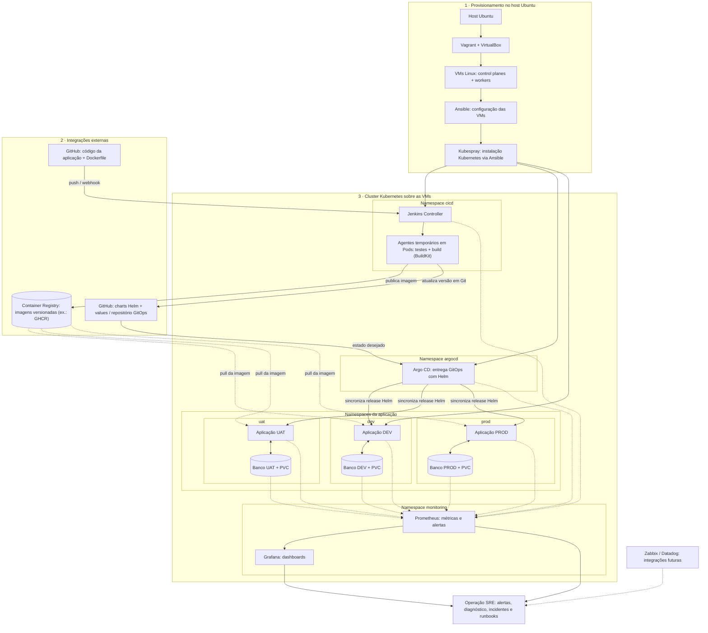

# SRE LAB 3.0

**Laboratório prático de Site Reliability Engineering (SRE) e Platform Engineering.**

Um ambiente de estudos progressivo para construir, operar, automatizar e evoluir uma plataforma de aplicações — do provisionamento da infraestrutura ao deploy contínuo, à observabilidade e à resposta a incidentes.

> **Proposta:** aprender fazendo, com um cenário integrado que se aproxima das tarefas de uma operação real. O objetivo não é apenas instalar ferramentas, mas entender **por que usá-las, como se relacionam e como diagnosticar falhas**.

## 🎯 Objetivos do projeto

- **Infraestrutura reproduzível:** preparar e administrar ambientes Linux e máquinas virtuais.
- **Orquestração de aplicações:** operar Kubernetes, seus recursos, armazenamento, rede e políticas de acesso.
- **Automação e entrega:** construir pipelines de CI/CD, empacotar aplicações e adotar GitOps.
- **Confiabilidade:** observar métricas, logs e alertas; investigar incidentes; validar recuperação e resiliência.
- **Portfólio técnico:** registrar decisões, comandos testados, problemas e aprendizados em documentação pública, sem expor informações sensíveis.

## 🗺️ Mapa de estudos e arquitetura

O laboratório foi planejado para conectar infraestrutura, aplicações, dados, entrega e operação em um **único ambiente de prática**.

*Mapa de estudos e prática: arquitetura, stack de ferramentas, etapas e evolução planejada do laboratório.*

### Visão geral da solução

A **arquitetura-alvo** separa o provisionamento do cluster, o ciclo de CI/CD e os serviços executados no Kubernetes. **Jenkins, Argo CD e a pilha principal de monitoramento ficam dentro do cluster**; GitHub e o registry de imagens continuam externos. O desenho representa a proposta de evolução, e não a instalação já concluída de todos os componentes.

#### Fluxo operacional

1. **Preparação do ambiente:** no **Ubuntu**, o **Vagrant** usa o **VirtualBox** para criar as VMs. **Ansible** prepara os servidores, e **Kubespray** (baseado em Ansible) instala e configura o **cluster Kubernetes**.
2. **CI dentro do Kubernetes:** um `git push` no **GitHub** aciona o **Jenkins Controller** no namespace `cicd`. Agentes efêmeros em Pods executam testes e constroem a imagem (por exemplo, com **BuildKit**, sem montar o socket Docker do host).
3. **Imagens e configuração versionadas:** o pipeline publica a imagem em um **registry externo**, como **GHCR**, e atualiza a referência da versão no Git que contém os **charts Helm** e os valores de cada ambiente.
4. **CD com GitOps:** o **Argo CD** no namespace `argocd` observa o estado desejado no Git e sincroniza os releases Helm. **Helm não é um serviço residente separado no cluster**: seus charts são processados pelo fluxo de entrega.
5. **Três ambientes paralelos:** `dev`, `uat` e `prod` possuem cada um **uma aplicação e um banco próprios**, com conexão interna via **Service/DNS** e armazenamento persistente **PVC** independente. A promoção de versões entre ambientes será controlada pelo fluxo GitOps.
6. **Observabilidade e resposta:** **Prometheus e Grafana**, no namespace `monitoring`, acompanham aplicações, bancos e componentes do cluster. **Zabbix/Datadog** entram como integrações posteriores; alertas e dashboards apoiam troubleshooting, runbooks e análise de incidentes.

**Decisões arquiteturais:** os control planes e workers são VMs criadas no host; **Jenkins, agentes, Argo CD, workloads e monitoramento principal executam como recursos Kubernetes**. Já **GitHub e registry de imagens são serviços externos**. A aplicação **consome** as imagens do registry; as imagens não ficam armazenadas permanentemente no Jenkins. Os namespaces `dev`, `uat` e `prod` isolam recursos de um **único cluster de laboratório** e não substituem a segregação entre clusters para uma produção real. **Terraform/Terragrunt** serão estudados em uma frente de IaC complementar, sem substituir o provisionamento local com Vagrant nesta fase.

> A imagem do mapa de estudos acima ilustra o roadmap geral. **O fluxograma Mermaid é a referência da arquitetura técnica pretendida** e será ajustado à medida que cada componente for efetivamente implementado e validado.

## 🧰 Tecnologias previstas

| Área | Ferramentas e conceitos |
| --- | --- |
| Base do laboratório | Linux, Git, Shell, Vagrant, VirtualBox |
| Contêineres e orquestração | Docker, Kubernetes, Helm |
| Provisionamento e configuração | Ansible, Kubespray, Terraform, Terragrunt |
| Entrega contínua | Jenkins, GitHub Actions, Argo CD, GitOps |
| Dados | PostgreSQL como banco principal e MySQL para estudos SQL; PV/PVC no Kubernetes |
| Observabilidade | Prometheus, Grafana, Zabbix e Datadog |
| Operação e confiabilidade | Troubleshooting, testes, falhas controladas, rollback, runbooks, SLOs e análise de incidentes |

A presença de uma ferramenta neste mapa **não significa que ela já está instalada ou integrada**: a implementação ocorre por etapas, conforme os exercícios avançam.

## 📐 Abordagem de estudo

Cada etapa segue um ciclo simples:

1. **Entender:** conceito, motivação e problema que a ferramenta resolve.
2. **Implementar:** aplicar no ambiente, com configuração e comandos explicados.
3. **Validar:** observar o resultado, investigar erros e confirmar o funcionamento.
4. **Revisar:** comparar alternativas e fixar os comandos essenciais.
5. **Repetir:** realizar um exercício curto para consolidar o aprendizado.

O laboratório evolui **progressivamente**: primeiro o deploy manual; depois, padronização com Helm; em seguida, automação com Jenkins; adoção de GitOps com Argo CD; e ampliação do CI/CD com GitHub Actions. Observabilidade e troubleshooting acompanham essa evolução.

## 🧭 Roadmap de alto nível

| Fase | Foco | Resultado esperado |
| --- | --- | --- |
| **01 · Fundamentos** | Linux, Git, Docker e Kubernetes | Ambiente operacional e domínio dos recursos básicos |
| **02 · Aplicação e infraestrutura** | Helm, SQL, Terraform/Terragrunt e Ansible | Aplicação implantável e infraestrutura documentada |
| **03 · Entrega e automação** | Jenkins, Argo CD e GitHub Actions | Pipeline de build, testes, deploy e recuperação |
| **04 · Confiabilidade** | Prometheus, Grafana, Zabbix, Datadog, testes e incidentes | Operação observável, resposta a falhas e melhoria contínua |

**Ambientes lógicos:** `dev`, `uat` e `prod` serão usados para praticar isolamento e promoção de versões. São ambientes de laboratório, não serviços reais de produção.

## 🏗️ Estado do laboratório

**Base já preparada e documentada:** Ubuntu, Vagrant/VirtualBox e Kubernetes provisionado via Kubespray. As demais integrações fazem parte do roadmap e terão o status atualizado conforme forem realmente implantadas e verificadas.

A topologia, os endereços, as versões e o estado das VMs podem mudar ao longo do projeto. A documentação de cada etapa deve registrar o que foi **executado e validado**, separadamente do que está **planejado**.

## 📚 Documentação prática

O README principal descreve a **visão e os objetivos**. Os procedimentos executáveis ficam nas pastas numeradas e serão adicionados gradualmente, sem transformar esta apresentação em um manual de comandos.

- [**Tema 01 — Iniciar o laboratório**](01-iniciar-laboratorio/README.md): guia de inicialização, acesso ao cluster, validação e desligamento.
- **Próximos temas:** serão publicados conforme os estudos e as práticas evoluírem.

O padrão de organização e publicação está em [SKILL.md](SKILL.md).

## ✅ Resultado esperado

Ao final do roadmap, o projeto deverá demonstrar um fluxo integrado de **infraestrutura → aplicação → entrega → observabilidade → resposta a incidentes**, com exemplos reproduzíveis, decisões explicadas e evidências de aprendizado.

---

*Projeto de estudos em evolução. Documentação em português, com terminologia técnica em inglês quando aplicável.*